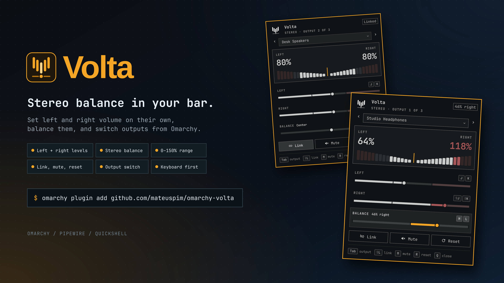

# Volta for Omarchy

Independent left/right output volume and stereo balance controls for the Omarchy bar.



## Features

- Separate left and right volume sliders, plus a centered balance control.
- Link channels, mute, reset to 100%, and select the active output sink.
- 0–150% range with a visible over-gain warning above 100%.
- Theme-native bar indicator with mouse, wheel, touchpad, and keyboard support.

## Install

```bash
omarchy plugin add https://github.com/mateuspim/omarchy-volta.git --enable
```

Remove it with:

```bash
omarchy plugin remove pym.volta
```

## Controls

On the bar: left click opens the popup, right click toggles mute, middle click resets both channels, and the wheel changes both channels by 5%.

In the popup:

| Key | Action |
| --- | --- |
| `j` / `k` | Left volume −/+ 5% |
| `Shift+j` / `Shift+k` | Right volume −/+ 5% |
| `h` / `l` | Balance left/right by 3% |
| `Left` / `Right`, `Shift+Tab` / `Tab` | Previous/next output |
| `Shift+l` | Link channels (averages them) |
| `m` | Mute/unmute |
| `r` | Reset to 100% and unlock |
| `q` / `Escape` | Close |
| `Up` / `Down` | Move between controls |

For compositor bindings, actions are also available through `omarchy-shell pym.volta-control`: `mute`, `reset`, `lock`, `leftUp`, `leftDown`, `rightUp`, `rightDown`, `balanceLeft`, `balanceRight`, `previousSink`, and `nextSink`.

## Requirements

- Omarchy 4.0+ with the Quickshell-based `omarchy-shell`
- PipeWire/WirePlumber
- A stereo output exposing `FrontLeft` and `FrontRight`

Mono outputs and channel maps without both front channels remain usable for mute and sink selection, but independent L/R controls are disabled.

## Backend

Volta uses Quickshell's native PipeWire API for reactive channel reads/writes, mute, and default-node changes. It uses Omarchy's `omarchy-audio-output-sink` and `omarchy-audio-output-set-default` helpers so speaker tuning/DSP routing follows the system audio panel. No daemon, sudo access, or continuously spawned volume command is required.

## Development

From a checkout, link the plugin into the user plugin directory (never `/usr/share/omarchy`):

```bash
ln -s /path/to/omarchy-volta ~/.config/omarchy/plugins/pym.volta
npm test
omarchy plugin validate .
omarchy-shell shell rescanPlugins
omarchy plugin enable pym.volta
```

Changes under the user plugin directory hot-reload with the shell.

## Troubleshooting

- **No output:** check `wpctl status`, then run `omarchy restart shell`.
- **Stereo controls disabled:** the selected sink is mono or lacks `FrontLeft`/`FrontRight`.
- **Plugin not visible:** run `omarchy plugin validate .`, rescan plugins, and enable `pym.volta`.
- **Wrong device behind DSP:** verify `omarchy-audio-output-sink`; Volta reports a visible error if resolution fails.
- **A value does not stick:** another audio policy may be changing it; Volta reflects the resulting PipeWire state.

## License

MIT
