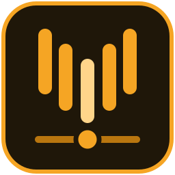

#  Volta


**Independent left and right output volume and stereo balance for the
Omarchy bar, on the native PipeWire API and Omarchy's own output rules.**

## Quick start

```bash
omarchy plugin add https://github.com/mateuspim/omarchy-volta.git --enable
```

Click the Volta mark in the bar, then use `j`/`k` for the left channel,
`Shift+j`/`Shift+k` for the right and `h`/`l` for balance.

## Features

- A stereo stage: large left and right readouts over a mirrored meter that
  grows out from the centre, so imbalance and over-gain show at a glance.
- Separate left and right volume sliders, plus a balance control that
  fills from a centre detent and keeps the louder side's level.
- Link channels, mute, reset to 100 %, and choose the active output.
- 0-150 % range; the 100-150 % over-gain zone is tinted on every meter
  and slider.
- Follows Omarchy's speaker tuning and DSP routing, like the system audio
  panel.
- Theme-native: the popup draws only from your Omarchy theme colours.
- Keyboard first, with the keys shown as keycaps beside each control; mouse,
  wheel and touchpad work too.
- Shows when PipeWire or another policy did not keep a change.
- IPC actions for your own key bindings; no global bindings installed.

## Install

```bash
omarchy plugin add https://github.com/mateuspim/omarchy-volta.git --enable
```

## Remove

```bash
omarchy plugin remove pym.volta
```

Volta keeps no settings file, so nothing is left behind.

## Security and privileges

Volta runs inside `omarchy-shell` as your user. It changes only the current
output's volume, mute and the default output, through PipeWire and Omarchy's
audio helpers. No root, no network, no config files. Details in
[SECURITY.md](SECURITY.md).

## Controls

On the bar: left click opens the popup, right click toggles mute, middle
click resets both channels, and the wheel changes both channels by 5 %.

In the popup:

| Key | Action |
| --- | --- |
| `j` / `k` | Left volume −/+ 5 % |
| `Shift+j` / `Shift+k` | Right volume −/+ 5 % |
| `h` / `l` | Balance left/right by 3 % |
| `Shift+l` | Link channels (averages them) |
| `m` | Mute/unmute |
| `r` | Reset to 100 % and unlink |
| `Tab` / `Shift+Tab` | Next/previous output |
| `Up` / `Down` | Move between controls |
| `Left` / `Right` | Previous/next output, or adjust the selected slider |
| `Enter` / `Space` | Open the output list, or press the selected button |
| `q` / `Escape` | Close |

The full map is in [docs/specs/keyboard.md](docs/specs/keyboard.md).

## Key bindings outside the popup

Volta does not install global compositor bindings. Its actions are available
through `omarchy-shell pym.volta-control <action>`: `mute`, `reset`, `lock`,
`leftUp`, `leftDown`, `rightUp`, `rightDown`, `balanceLeft`, `balanceRight`,
`previousSink` and `nextSink`. Bind the ones you want in
`~/.config/hypr/bindings.lua`, for example:

```lua
o.bind("SUPER + CTRL + ALT + comma", "Volta balance left", "omarchy-shell pym.volta-control balanceLeft")
```

See [docs/specs/ipc.md](docs/specs/ipc.md) for what each action does.

## Mono and other outputs

Volta needs an output with `FrontLeft` and `FrontRight` channels for
independent L/R control; on surround outputs it controls the front pair.
Mono outputs show a single volume slider and keep mute, reset and output
choice. Outputs without a front pair keep mute and output choice; L/R,
balance and link are disabled.

## Requirements

- Omarchy 4.0+ with the Quickshell-based `omarchy-shell`
- PipeWire/WirePlumber
- A stereo output exposing `FrontLeft` and `FrontRight` for L/R control

## Documentation

- [Documentation index](docs/README.md): architecture, decisions, specs and
  runbooks.
- [Troubleshooting](docs/runbooks/troubleshooting.md).
- [Contributing](CONTRIBUTING.md) and [Security](SECURITY.md).

## Development

Link a checkout to `~/.config/omarchy/plugins/pym.volta`, then run
`npm test` and `omarchy plugin validate .`. Check UI changes with the
offscreen harness (`tests/preview.sh`). Everything is in the
[development runbook](docs/runbooks/development.md).

## License

MIT. See [LICENSE](LICENSE).
